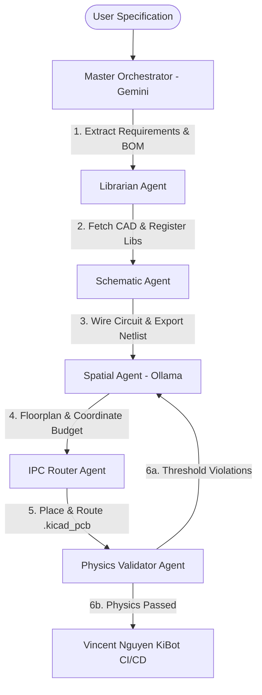

# Irona KiCad 10 AI Co-Pilot ⚡

[](https://github.com/example/irona_kicad/actions/workflows/ci.yml)
[](https://opensource.org/licenses/MIT)

**Irona KiCad** is an autonomous, end-to-end multi-agent hardware design system built for **KiCad 10**. It translates natural language hardware specifications into fully placed, routed, physics-validated (Power Integrity, Thermal, Signal Integrity), and manufacturing-ready PCBs with automated CI/CD documentation.

---

## 🏗️ Architecture & Multi-Agent Engine



### Core Agents

1. **Master Orchestrator (`agents/orchestrator.py`)**
   - Cloud AI reasoning via **Google Gemini** (`gemini-2.5-pro` / `gemini-2.5-flash`).
   - Analyzes user hardware requirements, selects circuit topology, and formulates component BOM.
2. **Spatial & Routing Agent (`agents/spatial_agent.py`)**
   - Spatial reasoning via local **Ollama** (`llama3.2-vision` / `mistral`).
   - Optimizes component placement, thermal spacing, and high-current trace geometry.
3. **Multi-Agent State Graph (`agents/graph.py` & `agents/state.py`)**
   - **LangGraph** workflow with automated closed-loop physics layout feedback.

---

## 🛠️ Tooling & EDA Integration Layer

| Tool | Module | Description |
| :--- | :--- | :--- |
| **CAD Librarian** | `tools/librarian.py` | Fetches CAD from Octopart / SnapMagic and updates `sym-lib-table` / `fp-lib-table`. |
| **Schematic Builder** | `tools/schematic_builder.py` | Generates KiCad 10 `.kicad_sch` S-expressions and JSON netlists. |
| **IPC Router** | `tools/ipc_router.py` | Connects to live KiCad 10 IPC socket or compiles directly to `.kicad_pcb`. |
| **Physics Solver** | `tools/physics_solver.py` | Headless Power Integrity (IR drop), Thermal (2D PDE diffusion), and Signal Integrity ($Z_0$). |
| **KiBot Automation** | `config/kibot.yaml` | Generates Interactive HTML BoM (iBoM), Gerbers, Drill files, PDFs, and 2D/3D renders. |

---

## 🚀 Quickstart & Usage

### 1. Installation

```bash
# Clone the repository
git clone https://github.com/example/irona_kicad.git
cd irona_kicad

# Install dependencies
pip install -r requirements.txt
```

### 2. Run Autonomous Design Co-Pilot

```bash
# Run end-to-end design generation
python main.py \
  --prompt "Design a 12V to 3.3V 2A Synchronous Step-Down Buck Converter with TPS54202" \
  --name buck_12v_3v3 \
  --output ./projects/buck_12v_3v3
```

### 3. Run Headless Multiphysics Verification

```bash
# Run standalone Power Integrity, Thermal, and Signal Integrity check
python tools/physics_solver.py \
  --board ./projects/buck_12v_3v3/buck_12v_3v3.kicad_pcb \
  --iout 2.0 \
  --check
```

### 4. Run Test Suite

```bash
python -m unittest discover -s tests -p "test_*.py" -v
```

---

## 📦 CI/CD & Automated KiBot Pipeline

The repository includes a GitHub Actions workflow (`.github/workflows/ci.yml`) following **Vincent Nguyen's KiBot matrix pattern**:

1. **Physics Simulation Gate**: Automatically checks IR drop ($<50\text{ mV}$), current density ($<35\text{ A/mm}^2$), and thermal limits ($<85^\circ\text{C}$).
2. **KiBot Documentation Package**:
   - **Interactive HTML BoM (`ibom`)** deployed to GitHub Pages.
   - **Fabrication Package**: RS-274X Gerbers, NC Excellon Drill files, Pick & Place CSVs.
   - **CAD Models**: 3D STEP export and high-resolution 2D renders.
   - **Documentation**: Schematic PDF printout with custom title block.
