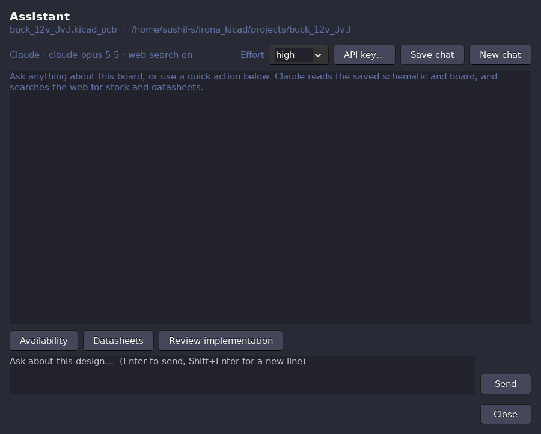

# Irona

Analysis and documentation tools for KiCad 9 and 10. Irona ships as five focused PCB Editor action plugins and a command-line interface that share one dependency-free Python core, plus an MCP server that connects the design to Claude Code, Claude Desktop and Antigravity.

| Plugin | Purpose |
| --- | --- |
| **Irona Simulator** | DC IR drop and current density per net, a lumped thermal hotspot estimate, and microstrip impedance per routed trace. |
| **Irona Rule Check** | Design-rule check of the board (clearance, drill, annular ring, edge clearance, unconnected items) and electrical-rule check of the schematic. |
| **Irona Design Review** | SI/PI review against IPC-2221/2222/2223/6012, plus a circuit review covering power rails, regulators, EMC pre-compliance and JLCPCB/PCBWay DFM. |
| **Irona Docs** | Design report PDF, schematic PDF, Gerbers and drill files, BOM and placement CSVs, a fabrication ZIP and an index page. |
| **Irona Assistant** | Chat with Claude about the open design: part availability and lifecycle, datasheets, and whether each part is connected and valued the way its datasheet requires. |

The plugin dialogs use the [Dracula](https://draculatheme.com) colour palette.

| Simulator | Design Review |
| --- | --- |
|  |  |
| **Rule Check** | **Docs** |
|  |  |
| **Assistant** | |
|  | |

## Requirements

- KiCad 9.0 or 10.0 (native or Flatpak) for the plugins
- Python 3.10 or later for the CLI; no third-party packages are required
- For the Assistant plugin and `irona ask` only: the [`anthropic`](https://pypi.org/project/anthropic/) package and an Anthropic API key. The MCP server needs neither.
- `kicad-cli` for Gerber, drill and schematic PDF export. It is found on `PATH`, inside the KiCad Flatpak, or via `flatpak run`. Without it those outputs are reported as skipped.

## Installation

```bash
git clone https://github.com/sushil-sundaram/irona.git
cd irona
python3 install_kicad_plugins.py
```

The installer copies the five plugins into the user plugin folder of every KiCad 9/10 installation it finds and points them at the cloned repository, so updating the repository updates the plugins after a KiCad restart. It also removes the earlier single-plugin release of Irona if present.

| Option | Effect |
| --- | --- |
| `--dry-run` | Print the changes without making them |
| `--assistant-deps` | Install the `anthropic` package into KiCad's Python (user site-packages; inside the Flatpak when KiCad is a Flatpak) |
| `--register-mcp` | Add the Irona MCP server to Antigravity, Claude Desktop and Claude Code (user scope). Existing config files are backed up as `*.bak` |
| `--uninstall` | Remove all Irona plugins (with `--register-mcp`, also the MCP registrations) |

Restart the PCB Editor, or choose **Tools → External Plugins → Refresh Plugins**. The plugins appear on the toolbar and under **Tools → External Plugins**.

## Using the plugins

The plugins read the project files on disk, so save the board and schematic before running them. Outputs are written to `<project>/irona-out/`.

- **Simulator** — enter the load current for each supply net and the dissipation of each power component, set the ambient temperature and limits, then select **Run**. Inputs are saved to `<project>/irona-sim.json` and reused by the CLI and the design report.
- **Rule Check** — set the minimum clearance and drill size, then select **Run**.
- **Design Review** — runs the SI/PI and circuit reviews; results can be filtered by severity, and the full Markdown report is available from **Open report**.
- **Docs** — select **Generate**. Double-click a result row to open that file.
- **Assistant** — ask a question, or use **Availability**, **Datasheets** or **Review implementation**. On first use, select **API key…**; the key is stored in `~/.config/irona/assistant.json`, readable only by you. **Effort** trades depth for speed and cost. **Save chat** writes the conversation to `<project>/irona-out/assistant/`.

## Assistant and MCP server

Both read the design through the same tools: a project overview (every part with value, footprint, MPN, manufacturer and datasheet link), per-part pin detail (pin name, electrical type, net and the pins it connects to), net listings, and Irona's rule check, design review and simulation. Connectivity comes from the saved board, pin names from the schematic's symbols, and part fields from the schematic.

- **Assistant plugin** — calls the Claude API (Claude Opus 5.5 by default) with server-side web search and web fetch, so Claude can check distributor stock and lifecycle and read datasheets, citing its sources. Usage is billed to your Anthropic API account.
- **MCP server** — `python3 -m irona mcp` serves the same tools over stdio to any MCP client, which brings its own model and web search: Claude Code, Claude Desktop or Antigravity, with no API key. Register it with `install_kicad_plugins.py --register-mcp`, or add it by hand:

```json
{
  "mcpServers": {
    "irona": {
      "command": "python3",
      "args": ["-m", "irona", "mcp", "--project", "/path/to/kicad/project"],
      "env": { "PYTHONPATH": "/path/to/irona" }
    }
  }
}
```

`--project` is optional: every tool also takes a `project` argument, and `find_projects` lists the KiCad projects under a folder.

Availability, pricing and datasheet details come from the web at the time of the question and can change; the Assistant's answers are a starting point for review, not a substitute for checking the datasheet.

## Command-line interface

```bash
python3 -m irona sim    PROJECT [--current NET=A ...] [--power REF=W ...] [--ambient C] [--save] [--check]
python3 -m irona check  PROJECT [--check]
python3 -m irona review PROJECT
python3 -m irona docs   PROJECT [--out DIR]
python3 -m irona ask    PROJECT "question" [--effort LEVEL] [--no-web] [--save]
python3 -m irona mcp    [--project PROJECT]
```

`sim`, `check`, `review` and `docs` print JSON; `ask` streams Claude's answer as text. With `--check`, the command exits with status 1 when a limit is exceeded or an error is found, which makes it suitable as a CI gate. When `sim` is run without inputs it uses those saved in `irona-sim.json`.

Example using the bundled sample project:

```bash
python3 -m irona sim projects/buck_12v_3v3 --current VOUT_3V3=2 --power U1=0.35 --save --check
python3 -m irona docs projects/buck_12v_3v3
```

`pip install .` additionally provides an `irona` executable.

## Methodology and limitations

Results are first-order engineering estimates intended to catch problems early. They do not replace field-solver or FEM analysis.

- **IR drop and current density** — R = ρL/(W·t) and J = I/(W·t), evaluated over power-width track segments (≥ 0.5 mm) of each net, assuming 1 oz copper.
- **Thermal** — natural-convection lumped model over the board outline (Edge.Cuts), with a 1.35 hotspot factor.
- **Impedance** — IPC-2141 surface microstrip formula, assuming 1.5 mm FR-4 and 1 oz copper.
- **Design review** — some SI/PI heuristics (switching hot loop, feedback-to-switch-node spacing) look for buck-converter net names such as `SW_NODE` and `FB`, and are skipped when those nets are absent.

## Development

```bash
python3 -m unittest discover -s tests -t .
```

The tests run against the sample projects in `projects/`. `buck_12v_3v3` is a clean reference design; `test_proj` contains deliberate DRC violations. GitHub Actions runs the tests and the simulation and rule-check gates on every push, and builds fabrication outputs with KiBot using `config/kibot.yaml`.

### Repository layout

```
irona/                  core library (standard library only)
  simulation.py         board simulator
  drc.py, erc.py        rule checks
  sipi_review.py        SI/PI and IPC review
  circuit_review.py     circuit review (wraps the vendored analyzers in happy/)
  report_pdf.py         PDF design report
  docs.py               kicad-cli exports, BOM, placement, fab package
  design_context.py     parts, fields and pin-to-net connectivity of a project
  assistant_tools.py    design tools shared by the Assistant and the MCP server
  assistant.py          Claude API chat (Assistant plugin, irona ask)
  mcp_server.py         MCP server (stdio)
  kicad_ui.py           shared plugin registration and dialog base
  theme.py              colour palette
  cli.py                command-line interface
plugins/irona_*/        KiCad action plugins, one per tool
projects/               sample projects used by the tests
tests/                  unit tests
config/kibot.yaml       KiBot configuration used in CI
graphify-out/           generated code knowledge graph
install_kicad_plugins.py
```

## Acknowledgements

- [kicad-happy](https://github.com/aklofas/kicad-happy) by aklofas: the circuit review uses its analyzers, vendored in `irona/happy/`. See that project for its licence terms.
- [KDT_Hierarchical_KiBot](https://github.com/nguyen-v/KDT_Hierarchical_KiBot) by nguyen-v: the KiBot documentation and fabrication configuration in `config/kibot.yaml` follows its approach.

## License

Irona is released under the [MIT License](LICENSE). The vendored code in `irona/happy/` remains under the licence of the kicad-happy project.
